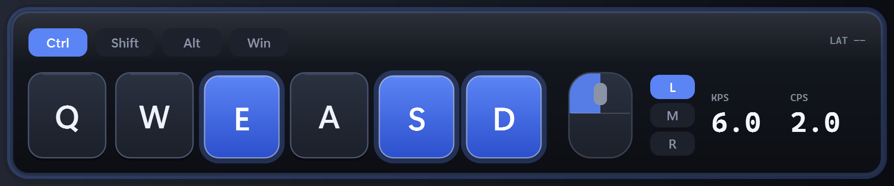
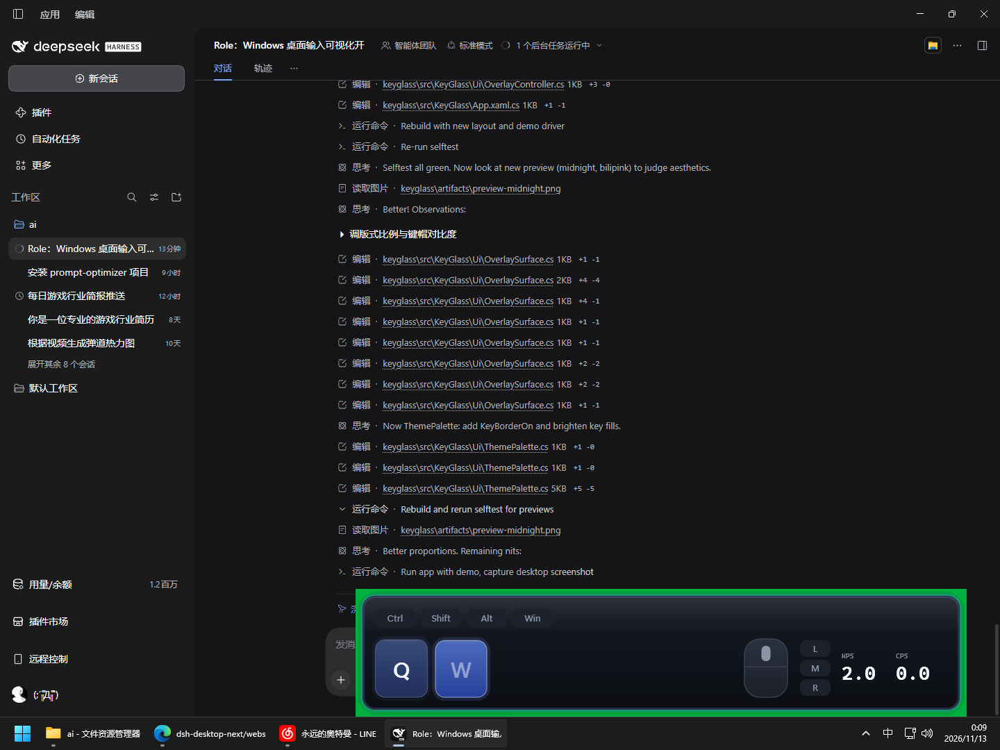
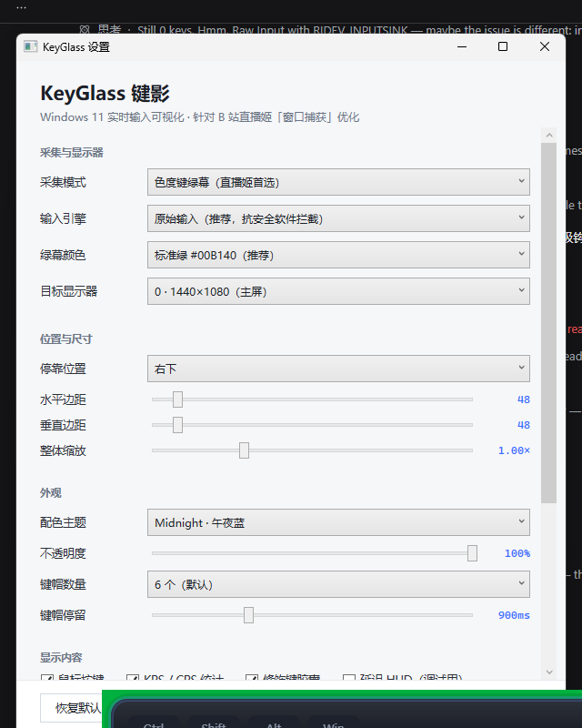

# KeyGlass 键影

> Windows 11 实时键盘 / 鼠标输入可视化叠加层 —— 为 **B 站直播姬「窗口捕获」** 设计。
> Real-time keyboard & mouse input visualizer for Windows 11, built for Bilibili Live Studio.

[](https://github.com/punishernana/keyglass/actions/workflows/build.yml) `C# / .NET 8 / WPF` · `零第三方依赖` · `自包含免安装` · `单帧 0.5ms / 空闲 CPU 0.02%` · MIT License

Windows 11 上把**键盘按键 / 鼠标点击**实时画到屏幕上的轻量叠加层，专为 **B 站直播姬「窗口捕获」** 设计。

- 自研实现，不依赖、不打包 Keyviz / Input Overlay（只借鉴了「按下即浮出键帽」这类交互思路）
- 绿色免安装：`dist\KeyGlass\KeyGlass.exe`，双击即用，**目标机不需要装 .NET**
- 鼠标穿透 / 不抢焦点 / 不进 Alt+Tab，直播时不干扰你操作
- 默认**色度键绿幕**：直播姬加「窗口捕获 + 色度键」就能干净抠出叠加层



| 在桌面上的样子（绿幕可见） | 设置窗口 |
| --- | --- |
|  |  |

---

## 下载（普通用户看这里）

- **免安装包（61.7MB）**：[KeyGlass-v1.0.0-win-x64.zip](https://github.com/punishernana/keyglass/releases/download/v1.0.0/KeyGlass-v1.0.0-win-x64.zip)
  解压后双击 `KeyGlass.exe`，无需安装 .NET。
- 历史版本：[Releases](https://github.com/punishernana/keyglass/releases)
- 想自己编译：见下文「自己构建」。

> 未签名程序可能触发 SmartScreen / 杀软提示：本项目不联网、不上传数据、不注入进程，源码可查（`src/KeyGlass`）。
## 1. 三步开始

0. **先装上**（不要放在被系统策略限制的目录里运行，见下面「已知限制」）：
   ```powershell
   powershell -NoProfile -ExecutionPolicy Bypass -File tools\install.ps1
   ```
   会装到 `C:\Program Files\KeyGlass` 并建桌面快捷方式。
1. 双击桌面「KeyGlass 键影」。托盘出现图标，右下角出现叠加层（首次会弹出设置窗口）。
2. 直播姬 → **添加来源 → 窗口捕获 → 选 `KeyGlass 叠加层（直播姬采集这个）`**。
   > 别选 `KeyGlass 设置（不要采集这个）`：设置窗口和叠加层在右下角有重叠，采错窗口会出现「键帽只出现在设置页面里、最小化设置后直播姬只剩桌面」的假象。
3. 在该来源上加 **色度键** 滤镜：颜色 `#00B140`（默认绿幕色），相似度 15%–25%。

找不到窗口？把设置里的「从 Alt+Tab 隐藏」关掉再试；或者改用「显示器捕获 + 裁剪」，把叠加层拖到画面角落。

## 2. 快捷键与托盘

| 操作 | 说明 |
| --- | --- |
| `Ctrl+Alt+K` | 显示 / 隐藏叠加层（可改，见配置 `hotkey`） |
| **再次双击 `KeyGlass.exe`** | 直接把设置窗口拉到前台（单实例，不需要找托盘） |
| 双击托盘图标 | 打开设置 |
| 托盘右键 | 显示/隐藏、采集模式切换、退出 |

> Windows 11 默认把新出现的托盘图标塞进溢出区（任务栏右下角的 `^`）。找不到图标时点 `^`，把蓝色「K」键帽拖到任务栏上；或者直接再次双击 exe —— 设置窗口会被带到前台，完全不依赖托盘。

设置项都是**即时生效**的：一边看画面一边调位置、缩放、主题。

## 3. 配置

配置文件：`%APPDATA%\KeyGlass\settings.json`（设置窗口「打开配置目录」可直接跳转）。

| 键 | 默认 | 说明 |
| --- | --- | --- |
| `anchor` | `BR` | 停靠位置：`TL TC TR / ML MC MR / BL BC BR` |
| `marginX` `marginY` | `48` | 距屏幕边缘的内边距（DIP） |
| `scale` | `1.0` | 整体缩放 0.6–2.0 |
| `captureMode` | `Chroma` | `Chroma` 绿幕（推荐）/ `Transparent` 透明叠加 |
| `chromaColor` | `#00B140` | 绿幕颜色，要和直播姬色度键一致 |
| `inputEngine` | `Auto` | `Auto` 原始输入+轮询兜底（推荐）/ `RawInput` / `LowLevelHook` / `Polling` |
| `theme` | `Midnight` | `Midnight` `Carbon` `Sakura` `Lime` `BiliPink` |
| `opacity` | `1.0` | 透明度（仅透明模式生效） |
| `showMouse` `showStats` `showModifiers` | `true` | 鼠标图形 / KPS·CPS / 修饰键胶囊 |
| `showLatencyHud` | `false` | 延迟 HUD（调试用） |
| `chipCapacity` | `6` | 同时显示的键帽槽数 4–8 |
| `chipLingerMs` | `900` | 松键后键帽停留时长 |
| `hideFromAltTab` | `true` | 从 Alt+Tab / 任务栏隐藏 |
| `hideOnScreen` | `false` | 不在本机屏幕显示，只给直播姬采集（窗口挪到屏幕外） |
| `monitorIndex` | `0` | 目标显示器序号 |
| `startHidden` | `false` | 启动时隐藏 |
| `hotkey` | `Ctrl+Alt+K` | 只支持改配置文件，格式如 `Ctrl+Shift+F9` |

## 4. 自己构建

```powershell
# 需要 .NET 8 SDK；首次 restore 需要联网，之后可以离线
powershell -NoProfile -ExecutionPolicy Bypass -File tools\build.ps1
```

产物：`dist\KeyGlass\KeyGlass.exe`（**文件夹版**，自包含、启动不外解包，最稳）。

如果想要单文件便携版（约 140MB，启动时会解包到 `%TEMP%\.net`）：

```powershell
... -File tools\build.ps1 -SingleFile      # 产物 dist-single\KeyGlass.exe
```

想要瘦身（约 1MB，但目标机需装 .NET 8 Desktop Runtime）：

```powershell
... -File tools\build.ps1 -FrameworkDependent
```

运行时**零第三方依赖**：只用 .NET 8 官方 BCL / WPF，项目里没有任何 NuGet 包。

## 5. 测试

```powershell
# 自检：输入源注册、状态机、5 套主题离屏渲染 → artifacts\selftest.json + 预览图
dist\KeyGlass\KeyGlass.exe --selftest --out artifacts

# 端到端冒烟：管线链路（队列→状态机→渲染→指标）+ 全局快捷键
powershell -NoProfile -ExecutionPolicy Bypass -File tools\smoke-test.ps1 -Exe dist\KeyGlass\KeyGlass.exe

# 性能实测：空闲 / 打字时的 CPU、内存、延迟分位数
powershell -NoProfile -ExecutionPolicy Bypass -File tools\measure-perf.ps1 -Exe dist\KeyGlass\KeyGlass.exe -Demo
```

本机实测（Windows 11 25H2 / 1440×1080 / WPF tier 2）：

| 指标 | 实测 |
| --- | --- |
| 空闲 CPU | 0.02%（整机） |
| 持续打字 CPU | 0.64%（整机，约 11% 单核） |
| 工作集 | 155–176 MB（私有 59–118 MB） |
| 输入→首帧渲染提交 | p50 0.5ms / p95 1.4ms |
| 渲染帧率 | 72 fps |

## 6. 已知限制与故障排查

- **双击没反应（最常见）**：如果你用的是单文件版（`dist-single\KeyGlass.exe`），它启动时要先把内嵌运行库解包到 `%TEMP%\.net`；受限环境/安全软件禁止往临时目录释放可执行文件时，进程会在解包阶段**静默退出**（CoreHost 退出码 `0x800080A0`），界面根本不会出现。**改用文件夹版 `dist\KeyGlass\KeyGlass.exe` 即可**（不做解包）。必须用单文件版时，可先设环境变量 `DOTNET_BUNDLE_EXTRACT_BASE_DIR` 指向可写目录再启动。
- **按键只在设置窗口里有反应，切走就失效（已定位）**：把程序放在受策略限制的目录（某些沙盘 / 被接管的目录）时，系统会强制它以 **Low 完整性** 运行，而 Low 进程看不到发往普通窗口的输入。**解决办法：装到 `C:\Program Files\KeyGlass` 或桌面**（`tools\install.ps1` 一键安装 + 建桌面快捷方式）。程序启动会自检，受限时托盘会提示。
- **按键没反应 / 只在设置页面上出现**：先看屏幕右下角的面板会不会出键帽。
  - 屏幕上正常、直播姬里没有 → **采集的窗口选错了**，改选 `KeyGlass 叠加层（直播姬采集这个）`。
  - 屏幕上也不出 → 设置里把「输入引擎」按 `自动 → 只用轮询 → 低级钩子` 依次试，或在安全软件里放行 KeyGlass。
  - 面板 KPS 在涨但没键帽 → 输入到了、渲染没跟上，把 `logs\diag.log` 发出来。
  - 详细日志：`dist\KeyGlass\logs\diag.log`（每 5 秒一行：输入增量、按键/点击计数、前台窗口、窗口可见性）。
- **独占全屏游戏**：叠加层与直播姬都抓不到，请改成「无边框窗口化」。
- **管理员权限的程序**：普通权限运行时，部分提权窗口的输入可能拿不到；需要时右键「以管理员身份运行」。
- **单一实例**：正常启动只允许一个实例（`--demo` / `--snapshot` 等开发参数会放行）。
- **不要只拷走 exe**：文件夹版的 `KeyGlass.exe` 依赖同目录的 dll 与 runtime 文件，整个目录一起搬。

## 7. 目录

```
keyglass/
  src/KeyGlass/           应用源码（Core 输入链路 / Ui 渲染与窗口 / Config 配置）
  tools/                  build.ps1 构建、smoke-test.ps1 冒烟、measure-perf.ps1 性能
  docs/                   交付文档、验收清单、截图
  dist/KeyGlass/          构建产物：文件夹版（双击 KeyGlass.exe）
  dist-single/            可选：单文件便携版
```

更完整的设计说明、取舍与验收约定见 **[docs/交付文档.md](docs/交付文档.md)**，逐条核对见 **[docs/验收清单.md](docs/验收清单.md)**。

## 8. 已验证的「自己看不到、直播姬能采到」

- 直播姬的窗口捕获内置 OBS 的 `window_capture`（`method=0` 自动 → WGC）。
- WGC 抓窗口表面：**遮挡无关**，但**完全在屏幕外抓不到**。
- 因此用 `hideOnScreen=true` + `hideMode=peek`：窗口只留 16px 在屏内、被任务栏盖住 → 人眼看不到，直播姬照抓。实测通过。
- `hideMode=offscreen` 在直播姬下会空白（DWM 不再合成屏幕外窗口），仅适合能抓屏幕外窗口的采集端。
- `captureMode=Transparent` 下 WGC 保留 alpha，直播姬直接叠加即可，不需要色度键。
## 文档索引

| 文档 | 内容 |
| --- | --- |
| [README.md](README.md) | 上手：3 步接入直播姬、配置项、构建、故障排查 |
| [docs/交付文档.md](docs/交付文档.md) | 技术底稿：需求边界、选型对比（含实测数据）、架构、关键实现、直播姬适配、取舍与验收约定 |
| [docs/验收清单.md](docs/验收清单.md) | 逐条验收项 + 本机实测值 + 复现命令 |
| [docs/GitHub发布指南.md](docs/GitHub发布指南.md) | 零基础上传到 GitHub / 发 Release 的步骤 |
| [CHANGELOG.md](CHANGELOG.md) | 版本变更 |

## 许可

[MIT](LICENSE) —— 可商用、可修改，保留版权声明即可。

> 本项目为独立实现：**没有**下载、打包或复用 Keyviz / Input Overlay 的任何代码与资源，
> 仅在交互思路（按下即浮出键帽、暗色玻璃面板）上做过参考。
