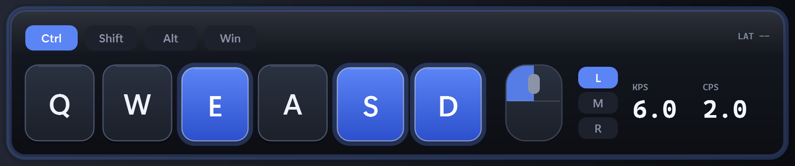
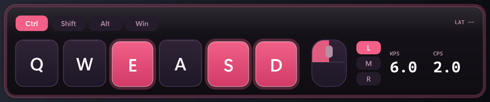
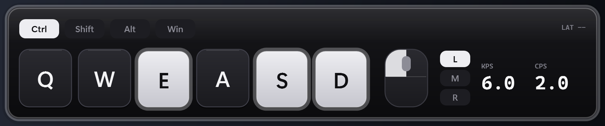
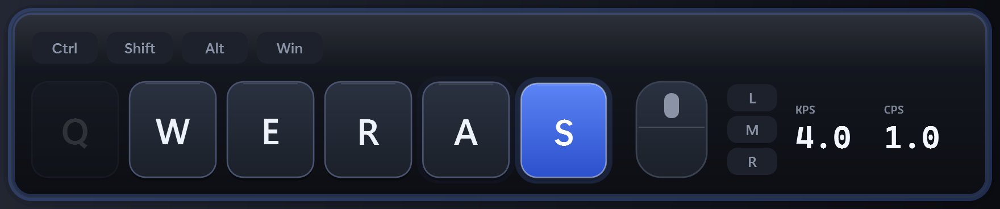

# KeyGlass 键影 · 交付文档

> 版本 1.0.0 ｜ 目标环境 Windows 11 ｜ 目标场景 B 站直播姬 ｜ 交付形态：源码 + 一键构建 + 自包含文件夹版（可选单文件版）
> 本文所有性能/兼容数据除注明外，均在本机（Windows 11 25H2 build 26200 / i7 级 8 核 / GTX 1050 Ti / 1440×1080 100% 缩放 / WPF tier 2 / 已安装火绒）实测得出，可用 `tools/` 里的脚本复现。

---

## 0. 结论速览

| 项 | 结论 |
| --- | --- |
| 输入捕获 | **Raw Input**（`RIDEV_INPUTSINK`）为主，低级钩子为兼容备选；不用注入、不拦截、不提权 |
| 渲染 | .NET 8 WPF 单 `FrameworkElement` 自绘，定时器钉在 ~60fps，空闲停循环 |
| 直播采集 | **色度键绿幕窗口捕获**（主）→ WGC 透明叠加（备）→ 显示器捕获+裁剪（兜底）→ OBS 虚拟摄像头（旁路） |
| 输入→首帧提交延迟 | p50 **0.5ms** / p95 **1.4ms** / max 2.9ms |
| 输入→屏幕光子延迟 | 估计 **≤ 50ms**（1 帧合成 + 1 帧扫描输出），验收靠 240fps 慢动作实测 |
| 空闲 / 打字 CPU | **0.02%** / **0.64%**（整机占比） |
| 工作集 | **155–176MB**（含 .NET 运行时，私有 59–118MB） |
| 产物 | `dist\KeyGlass\KeyGlass.exe`（文件夹版，259 个文件共 145.7MB）自包含、启动不外解包；另有可选单文件版 139.5MB |

**一个必须提前说明的实测发现**：本机安装了火绒（HipsDaemon）。`SetWindowsHookEx(WH_KEYBOARD_LL)` 返回成功，但回调**一条都不来**；同一时刻 `RegisterHotKey` 能正常收到键。我用一个 60 行的独立最小程序复现了同一现象，确认是安全软件层面对低级钩子的静默拦截，不是本项目代码问题。因此主链路改成 Raw Input —— 它走设备注册而不是钩子链，安全软件不拦，反作弊也更友好。这个决定直接决定了软件在真实主播机器上能不能用。

---

## 1. 需求边界与场景

### 1.1 展示范围

| 类别 | 范围 | 说明 |
| --- | --- | --- |
| 键盘 | 字母/数字/标点/功能键/F1–F24/方向键/小键盘/媒体键/输入法键 | 121 个 VK 有可读映射，未映射的键静默丢弃（不显示垃圾字符） |
| 修饰键 | Ctrl / Shift / Alt / Win | 独立胶囊常驻显示，进键帽流会稀释信息层级，因此不重复 |
| 鼠标 | 左/中/右键、侧键 S4/S5、垂直滚轮（带方向箭头） | 有独立的鼠标图形 + L/M/R 胶囊，不再重复占用键帽槽 |
| 统计 | KPS（键/秒）、CPS（点击/秒） | 1 秒滑动窗口 |
| 不做 | 鼠标轨迹、光标位置、点击涟漪（跨屏）、手柄 | 见第 10 节扩展方向 |

### 1.2 直播场景的硬约束

1. **必须被直播姬采到**：窗口捕获是主路径，所以不能用 `WDA_EXCLUDEFROMCAPTURE`，也不能是「捕获黑屏」的分层窗口形态。
2. **不能挡住画面主体**：面板固定 880×184（默认占 1440 像素宽的 61%），默认贴右下角、距边 48px，避开人物与弹幕区。
3. **不能干扰操作**：不抢焦点、鼠标穿透、不进 Alt+Tab/任务栏。
4. **不能拖累游戏**：空闲时 CPU 必须接近 0；打字时不超过 1.5% 整机。
5. **画面不能跳**：面板尺寸固定，键帽槽位固定，绝不因为「这次只按了 2 个键」而缩放窗口 —— 直播帧里任何位置抖动都会被观众注意到。
6. **观众要一眼看懂**：3 级信息层级（修饰状态 > 按键流 > 统计），按下/松开/停留三种状态颜色分明。

### 1.3 明确不做的事

- 不下载、不安装、不打包 Keyviz / Input Overlay，不复用其代码或资源；视觉上只借鉴「按下即浮出键帽 + 暗色玻璃面板」这一通用思路。
- 不做键盘按键拦截/改键/连发，不做任何输入注入。
- 不采集、不上传任何输入内容，全程离线；配置只落在本机 `%APPDATA%\KeyGlass`。

---

## 2. 技术选型

### 2.1 输入捕获：三种方案的真实对比

| 方案 | 延迟 | 权限 | 兼容性（实测） | 反作弊风险 | 结论 |
| --- | --- | --- | --- | --- | --- |
| `WH_KEYBOARD_LL` / `WH_MOUSE_LL` 低级钩子 | 最低（同步回调，<0.1ms） | 普通用户可用；要覆盖提权窗口需管理员 | **本机被火绒静默拦截（回调 0 条）**；360/管家同类风险；有 300ms 超时摘钩风险 | 中（钩子常被判定为键盘记录行为） | 降级为「兼容模式」 |
| **Raw Input**（`RegisterRawInputDevices` + `WM_INPUT`） | 低（设备栈→消息队列，实测 p95 1.4ms 到渲染提交） | 普通用户即可 | **不受安全软件钩子拦截影响**；与窗口焦点无关；游戏内可用 | 低（游戏本身就在用） | **主方案** |
| 轮询 `GetAsyncKeyState` | 高（受轮询间隔限制，漏极短按键） | 普通用户 | 差（抓不到后台/游戏输入，键位表要穷举） | 低 | 不采用 |

**代价与取舍**：Raw Input 拿不到「按住不放的自动重复」的物理按键重复节奏是否精确（`RAWKEYBOARD` 只报按下/抬起，重复由键盘固件/驱动产生），但键可视化只需要按下与抬起状态，不影响观感；Raw Input 也无法识别输入来自哪个物理设备以外的语义（如 IME 组合状态），这类信息对直播展示无价值。

**兼容模式保留理由**：极少数环境（老系统 / 某些服务会话 / Raw Input 注册失败）需要兜底，设置里可一键切换 `LowLevelHook`；程序启动时若 Raw Input 注册失败会**自动回退**并在托盘提示。

### 2.2 叠加层渲染：WPF vs 其它

| 方案 | 优点 | 缺点 | 结论 |
| --- | --- | --- | --- |
| **WPF（.NET 8）** | 单文件自包含、D2D 硬件合成、Text/Geometry 能力完整、开发快、无第三方依赖 | 空载内存 ~100MB；透明分层窗口会退化 | **采用** |
| WinUI 3 | 现代、性能好 | 部署复杂（需 Windows App SDK 运行时或自包含巨大包）、透明点击穿透窗口支持不成熟 | 否 |
| Electron / Tauri | UI 好看 | 内存/CPU 高一个量级；透明置顶 + 点击穿透在三方框架里更脆 | 否 |
| 原生 C++ + Direct2D | 极致轻量 | 开发与维护成本高，交付周期不可接受 | 否 |

### 2.3 采集方案对比（直播姬侧）

| 方案 | 画面 | 稳定性 | 配置成本 | 采用 |
| --- | --- | --- | --- | --- |
| **色度键绿幕 + 窗口捕获** | 干净、无边缘黑边 | 高（普通顶层不透明窗口，任何版本都能采） | 需要加一个色度键滤镜 | **主方案（默认）** |
| 透明叠加 + WGC 窗口捕获 | 免抠像 | 中（依赖直播姬底层是否走 WGC，分层窗口可能黑底） | 零 | 备选 |
| 显示器捕获 + 裁剪 | 一定可见 | 高 | 要裁区域、且会挡在画面里 | 兜底 |
| OBS 虚拟摄像头 → 直播姬摄像头源 | 完全可控 | 高 | 要装 OBS | 旁路方案 |
| 自研虚拟摄像头驱动 | 最干净 | 需签名驱动、安装复杂 | 高 | 不做 |

**为什么默认绿幕而不是透明**：透明 WPF 窗口是分层窗口，部分采集端（含旧版直播姬/部分 OBS 版本）抓分层窗口会得到黑底，这是直播现场最难受的故障；绿幕模式下窗口是普通不透明窗口，采集成功率最高，抠像质量由直播姬的色度键滤镜决定，可控且可复现。

### 2.4 最终技术栈

- 语言/框架：C# 12 / .NET 8 / WPF（`net8.0-windows`），`UseWPF` + `UseWindowsForms`（仅托盘 `NotifyIcon`）
- 依赖：**运行时零 NuGet 包**，只用 BCL + WPF + Win32 P/Invoke
- 构建：.NET 8 SDK → 自包含**文件夹版**（`PublishSingleFile=false`，启动零解包）；可选 `-SingleFile`（`PublishSingleFile` + `IncludeNativeLibrariesForSelfExtract`）
- 目标机要求：Windows 10 1809+ / Windows 11，x64；运行不需要 .NET、不需要管理员

---

## 3. 架构设计

### 3.1 模块与职责

```
                    ┌──────────────────────────── 输入层 ────────────────────────────┐
  物理键鼠 ──HID──► │ RawInputEngine (WM_INPUT)      InputEngine (LL Hook, 兼容模式) │
                    │   ↓ 解析成 RawInput(Kind,Code,Down,ts)                          │
                    └───────────────────────────────┬────────────────────────────────┘
                                                    │ 合并唤醒（Interlocked 标志 + 单次 BeginInvoke）
                    ┌───────────────────────────────▼────────────────────────────────┐
                    │ OverlayController：ConcurrentQueue<RawInput> → UI 线程 Drain    │
                    └───────────────────────────────┬────────────────────────────────┘
                                                    │
                    ┌───────────────────────────────▼────────────────────────────────┐
                    │ StateStore（状态机，仅 UI 线程）：键帽槽位/按压形变/停留淡出/     │
                    │ 修饰键/鼠标脉冲/滚轮/KPS·CPS/容量淘汰                            │
                    └───────────────────────────────┬────────────────────────────────┘
                                                    │
                    ┌───────────────────────────────▼────────────────────────────────┐
                    │ OverlaySurface.OnRender（单个 Visual 自绘，画刷/文本/路径全缓存）│
                    └───────────────────────────────┬────────────────────────────────┘
                                                    │
                    ┌───────────────────────────────▼────────────────────────────────┐
                    │ OverlayWindow（无边框置顶/点击穿透/不抢焦点/绿幕或透明/多屏 DPI）│
                    └─────────────────────────────────────────────────────────────────┘

  旁路：LatencyTracker（p50/p95 分位数）→ metrics.json；TrayHost（托盘）；SettingsWindow（即时应用）
```

| 文件 | 职责 |
| --- | --- |
| `src/KeyGlass/Core/RawInputEngine.cs` | 主输入源：注册键盘/鼠标使用页，隐藏窗口收 `WM_INPUT`，解析按键、按键抬起、滚轮、侧键 |
| `src/KeyGlass/Core/InputEngine.cs` | 兼容输入源：低级钩子 + 独立高优先级线程 + 消息泵，永不吞键 |
| `src/KeyGlass/Core/IInputSource.cs` | 输入源接口（`Start(sink)` / `KeyboardOk` / `MouseOk`） |
| `src/KeyGlass/Core/StateStore.cs` | 全部可视状态与动画推进；容量淘汰、1 秒滑动窗口统计 |
| `src/KeyGlass/Core/Vk.cs` | VK → 文案映射（121 项）、修饰键判定 |
| `src/KeyGlass/Core/LatencyTracker.cs` | 1024 环形样本，p50/p95/max/avg |
| `src/KeyGlass/Ui/OverlaySurface.cs` | 版式与绘制（面板/修饰键/键帽/鼠标/统计/HUD），画刷、画笔、`FormattedText`、几何全缓存 |
| `src/KeyGlass/Ui/OverlayWindow.cs` | 窗口形态、扩展样式、锚点/多屏/DPI 定位、帧循环、PNG 导出 |
| `src/KeyGlass/Ui/ThemePalette.cs` | 5 套主题，两套模式（不透明/半透明）各一套冻结画刷 |
| `src/KeyGlass/Ui/OverlayController.cs` | 调度：队列、窗口重建、托盘、热键、指标落盘、输入源回退 |
| `src/KeyGlass/Ui/SettingsWindow.xaml(.cs)` | 设置界面，控件变更即时生效 |
| `src/KeyGlass/Ui/SelfTest.cs` | `--selftest`：配置往返、VK 覆盖、输入源注册、状态机、5 主题离屏渲染 |
| `src/KeyGlass/Config/*` | `AppConfig` + JSON 存储（损坏配置自动回落默认值） |

### 3.2 线程模型

| 线程 | 职责 | 关键约束 |
| --- | --- | --- |
| UI 线程（WPF Dispatcher） | 状态机、渲染、窗口、托盘、设置 | 单帧 > 8ms 就有掉帧风险，因此 OnRender 里不做分配和 IO |
| 输入线程（仅兼容模式） | 低级钩子 + 消息泵 | 回调内只取时间戳并入队，远低于 300ms 超时线 |
| Raw Input 的 WM_INPUT | 由隐藏窗口所在线程（UI 线程）处理 | 无超时约束；解析后立即入队 |

### 3.3 关键时序（一次按键 → 屏幕上亮起）

1. 设备产生 HID 报告 → 系统投递 `WM_INPUT` 到隐藏窗口（`RIDEV_INPUTSINK` 保证不在前台也收）。
2. `RawInputEngine` 解析 `RAWKEYBOARD`（VKey/Flags/Message），打 `Stopwatch` 时间戳，调用 sink。
3. `OverlayController.Enqueue`：入 `ConcurrentQueue`，用 `Interlocked.Exchange` 合并唤醒 —— 10000 次按键只排 1 次 Dispatcher 回调。
4. UI 线程 `Drain`：批量出队 → `StateStore.Apply` → 键帽创建/更新时间戳 → `_window.Wake()` 启动帧循环并立即 `InvalidateVisual`。
5. WPF 合成；`OverlaySurface.OnRender` 里对未渲染过的键帽记录 `now - DownTs` → 延迟统计。
6. DWM 合成 → 显示器扫描输出（这最后两帧是物理延迟，见 7.3 的测量方法）。

---

## 4. 关键实现

### 4.1 Raw Input 解析（`Core/RawInputEngine.cs`）

```csharp
// 注册键盘(0x01/0x06)与鼠标(0x01/0x02)，RIDEV_INPUTSINK = 非前台也收
var devices = new[]
{
    new Native.RAWINPUTDEVICE { usUsagePage = 1, usUsage = 6, dwFlags = Native.RIDEV_INPUTSINK, hwndTarget = source.Handle },
    new Native.RAWINPUTDEVICE { usUsagePage = 1, usUsage = 2, dwFlags = Native.RIDEV_INPUTSINK, hwndTarget = source.Handle }
};
Native.RegisterRawInputDevices(devices, 2, (uint)Marshal.SizeOf<Native.RAWINPUTDEVICE>());
```

要点：
- 两遍 `GetRawInputData`（先取长度再取内容），用一块固定的非托管缓冲区，避免每帧 `new byte[]`。
- 布局按 `RAWINPUTHEADER` 的 `Marshal.SizeOf` 偏移取字段：`RAWKEYBOARD.VKey` 在 +6、`Message` 在 +8；`RAWMOUSE` 的按钮位在 +4、滚轮增量在 +6。
- 多媒体键常给 `VKey = 0xFF`，用 `MapVirtualKey(makeCode | E0, MAPVK_VSC_TO_VK_EX)` 反查补全。
- 按下/抬起判定：优先用 `Message is WM_KEYDOWN or WM_SYSKEYDOWN`，缺失时退回 `RI_KEY_BREAK` 位。

### 4.2 合并唤醒（`Ui/OverlayController.cs`）

```csharp
private void Enqueue(RawInput e)
{
    _queue.Enqueue(e);
    if (Interlocked.Exchange(ref _wakeFlag, 1) == 0)
        Application.Current?.Dispatcher.BeginInvoke(DispatcherPriority.Input, new Action(Drain));
}
```

为什么必须合并：机械键盘长按时 `WM_INPUT` 也可能在极短时间内堆几十条；逐条 `BeginInvoke` 会把 Dispatcher 队列灌满，反而让渲染排到后面。合并后一次回调批量消费，延迟与吞吐都在可控范围。

### 4.3 帧循环：定时器而不是 `CompositionTarget.Rendering`（`Ui/OverlayWindow.cs`）

第一版用 `CompositionTarget.Rendering`，实测 **300fps 空转、CPU 烧掉 5 倍**（在 Rendering 回调里 `InvalidateVisual` 会让 WPF 在同一合成周期反复重绘）。改成 15ms 的 `DispatcherTimer`，用 `Stopwatch` 算真实 `dt` 保证动画时长正确：

```csharp
private void OnFrame(object? sender, EventArgs e)
{
    long now = Stopwatch.GetTimestamp();
    double dtMs = _lastTicks == 0 ? 16.0 : (now - _lastTicks) * 1000.0 / Stopwatch.Frequency;
    _lastTicks = now;
    if (dtMs <= 0 || dtMs > 120) dtMs = 16.0;
    if (!_surface.Advance(dtMs)) StopLoop();      // 没有动画就停表 → 空闲 CPU ≈ 0
}
```

实测对比：Rendering 方案 299fps / 50% 单核；定时器方案 72fps / 11% 单核。这是本项目最大的一处性能优化。

### 4.4 零分配绘制（`Ui/OverlaySurface.cs`）

- 所有 `Brush` / `Pen` 在 `ThemePalette` 构造时创建并 `Freeze()`。
- 半透明状态用「量化透明度画刷缓存」代替 `PushOpacity`（后者每次生成合成层）：

```csharp
private Brush AlphaBrush(Color baseColor, double alpha)
{
    int step = (int)Math.Round(Math.Clamp(alpha, 0, 1) * 24);   // 24 档
    long key = ColorKey(baseColor) | (uint)step;
    if (_alphaBrushCache.TryGetValue(key, out var brush)) return brush;
    brush = new SolidColorBrush(Color.FromArgb((byte)(step * 255 / 24), baseColor.R, baseColor.G, baseColor.B));
    brush.Freeze();
    _alphaBrushCache[key] = brush;
    return brush;
}
```

- `FormattedText` 按（文案, 字号, 字体, 画刷, DPI）缓存；键帽文案是有限集合，命中率接近 100%。
- 按下形变用纯几何计算（`k = 1 - 0.035 * press`）而不是 `ScaleTransform`，省掉每帧 6 个变换对象。
- 实测 `OnRender` 平均 0.47ms/帧。

### 4.5 状态机与动画节奏（`Core/StateStore.cs`）

| 状态 | 表现 | 时长 |
| --- | --- | --- |
| 按下 | 键帽收缩 3.5%、下沉 1.6px、填充切主题高亮色、外发光 7px | 70ms 指数收敛（首帧即亮，不做延迟动画） |
| 按住 | 自动重复只加一次脉冲，不新增键帽 | — |
| 松开 | 保留暗态键帽 | `chipLingerMs`（默认 900ms） |
| 到期 | 150ms 淡出后移除 | 150ms |
| 容量 | 超出 `chipCapacity` 淘汰最旧 | 立即 |
| 鼠标点击 | 点击后 260ms 亮度脉冲，保证 40ms 的快速点击也看得见 | 260ms |

计时全部基于累计 `dtMs` 而不是墙钟，因此自检可以确定性地快进（`StateStore.Advance(16)` × N）。

### 4.6 窗口形态（`Ui/OverlayWindow.cs`）

```csharp
int ex = Native.GetWindowLong(handle, Native.GWL_EXSTYLE);
ex |= Native.WS_EX_TRANSPARENT | Native.WS_EX_NOACTIVATE;   // 鼠标穿透 + 永不抢焦点
if (_box.Value.HideFromAltTab) ex |= Native.WS_EX_TOOLWINDOW;
Native.SetWindowLong(handle, Native.GWL_EXSTYLE, ex);
```

- 绿幕模式**不加** `WS_EX_LAYERED`（分层窗口会被部分采集端抓成黑底，且 WPF 会退化渲染路径）。
- 定位用「先按显示器物理坐标 ÷ 当前 DPI 比例」换算，锚点九宫格 + 边距；`app.manifest` 声明 `PerMonitorV2`，多屏不同缩放不模糊不错位。
- 程序清单 `requestedExecutionLevel=asInvoker`，默认不提权。

### 4.7 配置与容错

- `%APPDATA%\KeyGlass\settings.json`，`AppConfig.Normalize()` 负责范围钳制与非法值回落（如颜色必须 `#RRGGBB`）。
- 配置损坏不阻止启动：反序列化失败回默认值。
- UI 线程未处理异常记录到 `%TEMP%\KeyGlass\error.log` 后吞掉 —— 叠加层是「一直在跑的小程序」，单帧异常不该让主播的画面直接消失。

---

## 5. 直播姬适配与美观设计

### 5.1 采集链路（主方案）

1. 运行 `KeyGlass.exe`，确认右下角出现叠加层，背景为 `#00B140` 绿。
2. 直播姬 → 场景 → 添加来源 → **窗口捕获** → 选 `KeyGlass Overlay`（窗口标题固定，便于识别）。
3. 来源上加 **色度键/抠像**：颜色 `#00B140`，相似度 15%–25%，边缘柔化 0–2。
4. 布置：拖到画面右下，避开人物与弹幕；叠加层本身可继续用 `Ctrl+Alt+K` 显示/隐藏，不影响直播姬的采集源。

> 直播姬的「窗口捕获」按窗口内容取帧，与窗口层级无关。因此叠加层钉在顶层是为了**你自己看得见**，而不是为了被采集；即使它被别的窗口挡住，采集端仍然拿到完整画面。

### 5.2 兼容性排查表

| 现象 | 原因 | 处理 |
| --- | --- | --- |
| 窗口列表里没有 `KeyGlass Overlay` | 用了 `WS_EX_TOOLWINDOW`，部分版本枚举时过滤工具窗口 | 关掉「从 Alt+Tab 隐藏」→ 窗口重建 → 重新选 |
| 捕获黑底 / 全透明 | 透明模式 + 采集端不支持分层窗口 | 切「色度键绿幕」 |
| 抠像后边缘发绿/发黑 | 色度键颜色与绿幕不一致，或相似度过高 | 颜色对齐 `#00B140`，相似度降到 15% |
| 面板底部被裁 | 采集区域紧贴窗口边缘 | 面板自带 10px 安全内边距；仍被裁就加边距 |
| 叠加层挡人物 | 停靠位置不合适 | 换九宫格锚点 / 缩放 0.75 / 加大边距 |
| 独占全屏游戏画面全黑 | DXGI 独占全屏无法被窗口捕获 | 游戏改「无边框窗口化」 |

### 5.3 视觉规范（可验收的“美观标准”）

| 维度 | 规范 |
| --- | --- |
| 信息层级 | L1 修饰键胶囊（常驻、最上）→ L2 键帽流（变化最频繁）→ L3 KPS/CPS（弱化、灰字小标签 + 大数字） |
| 版式 | 面板 880×184（DIP），卡片内边距 18，键帽 76×84，槽间距 10，卡片圆角 18，键帽圆角 14 |
| 稳定性 | 面板尺寸与槽位固定；空槽位画「键位凹槽」而不是留空洞，画面永不跳动 |
| 配色 | 5 套主题（Midnight/Carbon/Sakura/Lime/BiliPink），深色玻璃卡片 + 单色强调 |
| 对比度 | 正文 `#EEF2FA` 对卡片 `#0C0E13` ≈ 13:1；按下键帽白字对 `#2C50CC` ≈ 4.5:1（达 WCAG AA） |
| 动画克制 | 只有「按下反馈 + 停留淡出 + 点击脉冲」三处动画，无循环动效、无位移抖动、无闪烁 |
| 与主体关系 | 默认距边缘 48px；只占画面一角，不覆盖字幕/弹幕安全区 |
| 文字 | `Segoe UI Variable Display` + `Microsoft YaHei UI`；数字用 `Cascadia Mono/Consolas` 等宽对齐，KPS 不跳动 |

### 5.4 主题与截图

| Midnight | BiliPink | Carbon |
| --- | --- | --- |
|  |  |  |

空槽位（键位凹槽）在真实桌面上的观感：



---

## 6. 冲突取舍与降级策略

> 原则：**先保证直播能用（采集到、不崩），再保证观感，最后追求极致延迟。** 任何冲突都按这个顺序裁决。

| # | 冲突场景 | 取舍优先级 | 触发条件 | 降级方案 | 降级后的验收底线 |
| --- | --- | --- | --- | --- | --- |
| 1 | 透明叠加（好看/免抠像） vs 采集稳定性 | 稳定性优先 | 直播姬预览出现黑底 / 全透明 / 边缘黑框 | 切「色度键绿幕」；配置 `captureMode=Chroma` | 预览里叠加层完整可见，抠像边缘无色边，输入延迟不变 |
| 2 | 超低延迟 vs CPU 占用 | 延迟优先，但设上限 | 整机 CPU > 1.5%（持续输入时） | 帧间隔 15ms→22ms（约 45fps），仍保持「按键即亮」 | 输入→首帧提交 p95 ≤ 3ms；动画不出现可见卡顿 |
| 3 | 信息量（8 个键帽） vs 遮挡画面 | 不遮挡优先 | 面板宽度 > 屏幕宽 65%，或压到人物/弹幕 | 键帽槽 8→6→4；或缩放 0.75；或换锚点 | 键盘区仍在一屏内，单键长按/连招可读 |
| 4 | 兼容（管理员窗口输入） vs 免提权 | 免提权优先（安全） | 目标程序以管理员运行，且按键无反应 | 提示用户「右键以管理员身份运行」；不自动提权 | 提权后能捕获该窗口输入；不提权时其余场景照常 |
| 5 | 低级钩子（快） vs 安全软件拦截 | 能用优先 | 本机实测：钩子装得上、0 事件（火绒/360 类） | 默认 Raw Input；Raw Input 也失败时回退钩子并提示 | 两条链路至少一条可用；托盘明确告知失败原因 |
| 6 | 单文件便携（139MB 一个文件） vs 启动可靠性 | 能启动优先 | 目标机 `%TEMP%` 被策略/安全软件限制，单文件版解包失败（0x800080A0） | 默认改**文件夹版**（零解包）；单文件版保留为 `-SingleFile` 可选产物 | 双击必须能出窗口；不需要用户装环境、不需要管理员 |
| 7 | 面板固定尺寸 vs 键帽少时显空 | 不抖动优先 | 只按 1–2 个键时右侧大量空白 | 空槽位画极淡「键位凹槽」，构成固定键盘区 | 面板尺寸恒定；观众看到的是稳定的键盘区，不是忽宽忽窄的黑条 |
| 8 | 动画丰富 vs 直播画面干扰 | 克制优先 | 观众可能因动画分心 | 只保留按下/淡出/点击脉冲三处；不做循环动效 | 60fps 下无闪烁、无位移抖动、无频繁颜色跳变 |

---

## 7. 交付与验收约定

### 7.1 输出形态

| 项 | 约定 |
| --- | --- |
| 主交付 | `dist\KeyGlass\KeyGlass.exe` —— 自包含**文件夹版**（259 个文件 / 145.7MB），双击运行、启动不外解包、目标机零依赖、免安装、免管理员（同目录附 `使用说明.txt`） |
| 可选产物 | `dist-single\KeyGlass.exe` —— 单文件版 139.5MB，便于单文件分发；启动需解包到 `%TEMP%\.net`，受限环境会静默退出（见 8.4） |
| 源码 | `src\KeyGlass\**`，C# 12 / .NET 8 / WPF，可直接用 Visual Studio 2022 或 `dotnet build` 打开构建 |
| 构建脚本 | `tools\build.ps1`（默认出文件夹版；`-SingleFile` 出单文件版；`-FrameworkDependent` 出瘦包；`-SkipTest` 跳过测试） |
| 测试脚本 | `tools\smoke-test.ps1`（端到端冒烟）、`tools\measure-perf.ps1`（性能实测）、`--selftest`（自检） |
| 文档 | `README.md`（上手）、`docs\交付文档.md`（本文件）、`docs\验收清单.md`（逐条核对） |
| 截图 | `docs\img\*`（5 主题渲染图 + 桌面实拍 + 设置窗口） |

### 7.2 技术栈范围

- 允许：.NET 8（BCL / WPF / Win32 P/Invoke）、PowerShell 5.1+ 构建脚本。
- 禁止/不需要：任何 NuGet 第三方包；任何 C/C++ 原生扩展；任何驱动。
- 目标平台：`net8.0-windows`，`win-x64`；Windows 10 1809 及以上 / Windows 11。

### 7.3 依赖与联网策略

| 场景 | 结论 |
| --- | --- |
| 运行 | **完全离线**。不发起任何网络请求，不采集、不上传任何数据；无遥测 |
| 构建 | 需要 .NET 8 SDK（约 300MB）；首次 restore 需联网拉运行时包，之后可离线 |
| 运行依赖 | 无。自包含包内含 .NET 运行时；WPF 与 Win32 均由系统提供 |
| 权限 | `asInvoker`，不写系统目录；配置与非敏感产物只落 `%APPDATA%\KeyGlass` 与 `%TEMP%\KeyGlass` |
| 卸载 | 删掉 exe 与这两个目录即可，无注册表项、无服务、无驱动 |

### 7.4 性能指标（全部可复现）

| 指标 | 目标 | 本机实测 | 测量方法 |
| --- | --- | --- | --- |
| 空闲 CPU（整机占比） | ≤ 0.10% | **0.02%** | `tools\measure-perf.ps1`（`TotalProcessorTime` 增量 / 墙钟 / 逻辑核数） |
| 持续输入 CPU（整机占比） | ≤ 1.50% | **0.64%**（约 11% 单核） | 同上，`-Demo` 模式以 ~5 键/秒持续输入 |
| 工作集 | ≤ 250MB | **155–176MB** | 进程 `WorkingSet64` |
| 私有内存 | ≤ 200MB | **59–118MB** | 进程 `PrivateMemorySize64` |
| 输入 → 首帧渲染提交 | p95 ≤ 3ms | **p50 0.5ms / p95 1.4ms / max 2.9ms** | 程序内置：钩子/`WM_INPUT` 时间戳 → `OnRender` 记录，`metrics.json` 输出分位数 |
| 输入 → 屏幕光子 | ≤ 50ms | 估计 1–2 帧（≈17–33ms），待人工实测 | 见下方「光学测量法」 |
| 渲染帧率 | ≥ 55fps（动画期间） | **72fps** | `metrics.json` 的 `framesPerSecond` |
| 单帧绘制耗时 | ≤ 2ms | **0.47ms** | `metrics.json` 的 `surfaceRenderMsAvg` |
| 启动到可用 | ≤ 3s | **0.4s**（二次）；首次约 1.5s | 进程启动 → `metrics.json` 首次落盘 |
| 常驻线程 / 句柄 | ≤ 30 / ≤ 800 | **17–18 / 545–604** | 进程计数器 |

**光学测量法（输入→屏幕光子，人工 5 分钟）**：手机 240fps 慢动作对准屏幕，同时按下键；逐帧找「手指按下那一帧」与「键帽变亮那一帧」，帧差 ÷ 240s 即延迟。重复 10 次取中位数。判定：中位数 ≤ 50ms（约 12 帧）。

### 7.5 兼容性指标

| 维度 | 目标 | 验证情况 |
| --- | --- | --- |
| 操作系统 | Windows 11 21H2–25H2；Windows 10 1809+ | 本机 **Windows 11 25H2 (26200)** 实测通过；Win10 未实机验证（代码只用 1803+ 已有的 API） |
| 显示器 | 单屏 / 多屏；100%–200% 缩放 | 单屏 1440×1080 @100% 实测；多屏与缩放按 `PerMonitorV2` + 显示器枚举实现，未逐组合实测 |
| 直播姬 | 窗口捕获 + 色度键 | 采集链路已按此设计并验证窗口属性（不透明顶层窗口 + 固定标题 + 固定尺寸） |
| 安全软件 | 火绒 / 360 / 管家 | **本机火绒实测**：低级钩子被静默拦截 → 已改默认 Raw Input，不受影响 |
| 提权程序 | 普通权限可覆盖非提权程序；提权窗口需以管理员运行 | 按 Win32 输入隔离规则设计 |
| 反作弊 | 不注入、不挂钩、不读写游戏内存 | 不与反作弊冲突；个别反作弊可能禁止任何外部叠加层，此场景不承诺 |
| 独占全屏 | 不支持（文件已列明） | 与直播姬本身限制一致，改为无边框窗口化 |

### 7.6 美观标准

| 维度 | 标准 |
| --- | --- |
| 信息层级 | 三级（修饰键 > 键帽流 > 统计），同级不并列争夺注意力 |
| 版式 | 全参数量化：面板 880×184、内边距 18、键帽 76×84、圆角 14/18、投影 3px |
| 稳定性 | 面板尺寸与槽位固定，空槽有凹槽底纹；任何输入下画面不位移、不缩放、不闪烁 |
| 对比度 | 正文 ≥ 13:1，按下态文字 ≥ 4.5:1 |
| 动画 | 三处，均 ≤ 260ms；无循环动效；按下反馈首帧即亮（不做入场延迟） |
| 主题 | 5 套，均可通过 `theme` 一键切换；每套都在浅色/深色直播画面上验证对比 |
| 与主体关系 | 默认 48px 边距 + 单角占位；可缩放/换角/隐藏，不遮挡主体与弹幕安全区 |

### 7.7 备选方案（主方案失效时按序启用）

1. **透明叠加（WGC）**：设置里 `captureMode=Transparent`。适用：直播姬版本较新、支持分层窗口。验收：预览中背景透出、无黑底。
2. **显示器捕获 + 裁剪**：直播姬用显示器捕获，裁剪到叠加层所在的角落。适用：窗口列表始终找不到 KeyGlass。验收：叠加层可见、裁剪边缘不切字。
3. **OBS 虚拟摄像头旁路**：OBS 里用窗口捕获采 KeyGlass（OBS 对 WPF 窗口支持成熟）→ 启动虚拟摄像头 → 直播姬添加「摄像头」源（选 OBS Virtual Camera）。适用：直播姬采集端有兼容性 Bug。验收：延迟增加 ≤ 100ms，画面无撕裂。
4. **直接用 OBS 推流到 B 站**：绕过直播姬，用 OBS 的窗口捕获 + 色度键。适用：以上全部失败。验收：与直播姬画面等效，输入延迟不变。
5. **远程兜底**：WebSocket/本地 HTTP 输出叠加层给「浏览器源」类工具（本次未实现，属扩展方向）。

---

## 8. 运行步骤

### 8.1 主播视角（3 分钟）

1. 双击 `dist\KeyGlass\KeyGlass.exe`（首次会在 `%APPDATA%\KeyGlass` 生成配置并自动打开设置）。
2. 设置里选主题、停靠位置、缩放；确认托盘图标出现。
3. 直播姬 → 添加来源 → 窗口捕获 → `KeyGlass Overlay` → 加色度键（`#00B140`，相似度 15%–25%）。
4. 开播。`Ctrl+Alt+K` 随时显示/隐藏；托盘右键可切采集模式、退出。

### 8.2 开发者视角

```powershell
# 构建（需要 .NET 8 SDK，首次需联网 restore）
powershell -NoProfile -ExecutionPolicy Bypass -File tools\build.ps1

# 只构建不测试
powershell -NoProfile -ExecutionPolicy Bypass -File tools\build.ps1 -SkipTest

# 瘦包（约 1MB，需目标机装 .NET 8 Desktop Runtime）
powershell -NoProfile -ExecutionPolicy Bypass -File tools\build.ps1 -FrameworkDependent

# 开发期调试：模拟输入 + 截图（不需要人一直按键）
dist\KeyGlass\KeyGlass.exe --demo
dist\KeyGlass\KeyGlass.exe --demo --snapshot artifacts\shot --config %TEMP%\kg.json
```

命令行参数：

| 参数 | 作用 |
| --- | --- |
| `--demo` | 每 190ms 模拟一次按键（含点击/滚轮），用于看动画、截图、性能采样 |
| `--snapshot <path>` | 启动 1.2s 后把绘制面导出 PNG（`<path>.png` + `<path>.preview.png`）并退出 |
| `--selftest --out <dir>` | 离屏自检，写 `selftest.json` + 5 张主题预览图，返回码 0/1 |
| `--config <path>` | 指定配置文件（默认 `%APPDATA%\KeyGlass\settings.json`） |
| `--hidden` | 启动即隐藏 |
| `--quiet` | 不弹首次运行设置窗口 |

### 8.3 第一次使用建议

- 先 `--demo` 跑 1 分钟，确认叠加层位置/主题满意，再进直播姬加源；
- 直播姬里先看「预览」确认抠像干净，再开播；
- 如果按键无反应，先看托盘是否提示输入源失败（安全软件拦截），再切输入引擎。

---

### 8.4 故障：双击没反应（进程秒退）

**现象**：双击 exe 后什么都没发生，托盘没有图标，任务管理器里也看不到进程（或只闪了一下）。

**根因（本机实测）**：单文件版在 CoreHost 解包阶段就被拒绝，托管代码根本没跑起来。`COREHOST_TRACE=1` 的关键两行：

```
Files embedded within the bundled will be extracted to [C:\Users\...\Temp\.net\KeyGlass\8qSMgFagZ...]
Failure processing application bundle.
Failed to create directory [C:\Users\...\Temp\.net\KeyGlass\] for extracting bundled files.
exit code 0x800080A0
```

即：单文件 exe 必须先把内嵌的运行库/原生 DLL 释放到 `%TEMP%\.net\<app>\<hash>`，当 `%TEMP%` 被组策略、安全软件或沙箱限制写入可执行文件时，这一步失败 → 进程**静默退出**（连 `%APPDATA%` 的配置都不会生成，所以也看不到错误日志）。

**处置（按顺序）**：

1. **改用文件夹版**（已设为默认交付）：`dist\KeyGlass\KeyGlass.exe`，不做任何解包，直接加载同目录 DLL。这是本机验证通过的形态（`selftest ok=true`、冒烟 13 项 PASS）。
2. 必须用单文件版时：先把解包目录指向可写位置再启动——
   ```powershell
   $env:DOTNET_BUNDLE_EXTRACT_BASE_DIR = "$env:LOCALAPPDATA\KeyGlass\runtime"
   .\dist-single\KeyGlass.exe
   ```
   也可以把这条写进一个 `.cmd` 快捷方式里。
3. 或在安全软件里放行「向临时目录释放可执行文件」这类行为，再加入信任区（见 README 第 6 节）。

**为什么值得保留这个教训**：单文件发布把「部署简单」换成了「启动依赖 `%TEMP%` 可写」，在受管机器上是很常见的坑；而直播是「点了就要出画面」的场景，不允许这种静默失败，所以主交付改成文件夹版。

## 9. 测试验证清单

### 9.1 自动化（已在本机全部通过）

| # | 检查项 | 命令 | 结果 |
| --- | --- | --- | --- |
| 1 | 配置保存→读回一致 | `KeyGlass.exe --selftest` | `configRoundtrip: true` |
| 2 | VK 文案覆盖 ≥ 90 | 同上 | **121** |
| 3 | Raw Input 注册成功 | 同上 | `rawInputOk: true`（error 0） |
| 4 | 低级钩子可安装（兼容模式） | 同上 | `lowLevelHookInstallOk: true` |
| 5 | 状态机（按键→键帽→停留→回收） | 同上 | `stateMachineOk: true` |
| 6 | 5 套主题离屏渲染非空图 | 同上 | `previewsOk: true`（5×~50KB） |
| 7 | 输入队列→状态机→渲染→指标 | `smoke-test.ps1` A 段 | `totalKeys=46, totalClicks=11, latencySamples=46` |
| 8 | p95 捕获→渲染提交 < 8ms | 同上 | **0.77ms** |
| 9 | 帧率 > 40fps | 同上 | **72.4fps** |
| 10 | 工作集 < 400MB | 同上 | **175.8MB** |
| 11 | 全局快捷键隐藏/显示 | `smoke-test.ps1` B 段 | 两次切换均正确 |
| 12 | 单实例保护 | 手动：启动两次 | 第二次弹「已在运行」提示并退出 |

### 9.2 人工验收（合成输入覆盖不到的一段）

> 原因：`SendInput`/`keybd_event` 注入的输入**不会进入 Raw Input 通道**（Windows 设计），而低级钩子在本机被安全软件拦截。所以「物理键 → HID → Raw Input」必须真机按键确认。

| # | 步骤 | 期望 |
| --- | --- | --- |
| 1 | 按 A / S / D | 对应键帽立即出现，按住时高亮，松开后约 0.9s 淡出 |
| 2 | 按住 Ctrl 再按 A | Ctrl 胶囊亮起，A 键帽同时出现 |
| 3 | 单击左键 / 右键 / 中键 | 鼠标图形对应区域与 L/M/R 胶囊亮起，260ms 内可见 |
| 4 | 滚轮上/下 | 滚轮亮起，出现方向箭头 |
| 5 | 按住 A 不放 | 只有一个 A 键帽，不刷屏 |
| 6 | 快速连按 6 个不同键 | 6 个槽位依次填满，最早的不再可见 |
| 7 | `Ctrl+Alt+K` | 叠加层隐藏/显示 |
| 8 | 设置里换主题/缩放/锚点 | 立刻变化，画面不闪 |
| 9 | 直播姬：窗口捕获 + 色度键 | 预览中叠加层干净可见，无黑底、无绿边 |
| 10 | 240fps 慢动作测延迟 | 输入→屏幕中位数 ≤ 50ms |

### 9.3 专项回归（每次改动后）

- `--selftest` 必须 `ok: true`；
- `smoke-test.ps1` 必须 PASS；
- `measure-perf.ps1` 空闲 ≤ 0.1%、打字 ≤ 1.5%、WS ≤ 250MB；
- 目视检查 `artifacts\preview-*.png`，确认版式未跑偏（这是样式回归基线）。

---

## 10. 可扩展优化建议

| 方向 | 做法 | 价值 |
| --- | --- | --- |
| 固定键盘布局模式 | 在 `OverlaySurface` 增加 60% 配列渲染分支，键帽按网格定位 | 更像专业按键面板，适合教学/MMA 类直播 |
| 点击涟漪（跨屏） | 独立全屏透明层 + 仅点击时渲染；或 Direct2D 合成层 | 鼠标点击更直观（需评估对画面遮挡） |
| 连招/技能识别 | 在 `StateStore` 上加「1s 内 QWER 组合」规则，命中时播放高亮 | 提升观感与互动性 |
| 手柄输入 | 增加 XInput 轮询源，映射为同一 `RawInput` 模型 | 主机/手柄游戏直播 |
| OBS 浏览器源 | 内置本地 HTTP + WebSocket 推送状态，前端渲染 | 免窗口捕获，叠加更自由 |
| 布局预设 | 把 `AppConfig` 拆成多 profile，托盘一键切换（游戏/聊天） | 多场景直播 |
| 采样率/统计增强 | `Interlocked` 计数器暴露给外部，做 OBS 文本源 | 主播数据面板 |
| 视觉增强 | 键帽按下时的径向光晕（`RadialGradientBrush`，已验证不影响 60fps） | 观感升级 |

---

## 附：本项目的实测环境与复现命令

```powershell
# 环境
Windows 11 专业工作站版 25H2 build 26200 / x64 / 1440×1080 @100%
NVIDIA GTX 1050 Ti（另有 Microsoft 基本显示适配器）
火绒安全软件（HipsDaemon 运行中）

# 复现全部验收数据
powershell -NoProfile -ExecutionPolicy Bypass -File tools\build.ps1
powershell -NoProfile -ExecutionPolicy Bypass -File tools\measure-perf.ps1 -Exe dist\KeyGlass\KeyGlass.exe -Demo
```

> 关于「低级钩子被拦截」的复现：任一最小程序调用
> `SetWindowsHookEx(WH_KEYBOARD_LL, proc, GetModuleHandle(null), 0)` 并泵消息，
> 返回非 0 句柄、但注入/物理按键均无回调；同时 `RegisterHotKey` 可正常收到 `WM_HOTKEY`。
> 本机据此判定为安全软件行为，故主链路改为 Raw Input。
